# Sushi Latte — Overview and Flows

This document explains the project's documentation at a high level and maps every operational and backend flow as a chart. Its purpose is to test the spec: every branch in a chart is backed by a rule in the [BRD](BRD.md) or [TRD](TRD.md). Branches that came from the gap review are tagged **✅ G-nn** and listed in the [Gap resolution log](#6-gap-resolution-log). If you find a branch with no rule, the spec needs a revision.

Charts use Mermaid. They render on GitHub and in VS Code with a Mermaid-enabled Markdown preview (e.g. the *Markdown Preview Mermaid Support* extension).

**Contents**

1. [Document map](#1-document-map)
2. [System at a glance](#2-system-at-a-glance)
3. [Operational workflows](#3-operational-workflows)
4. [State machines](#4-state-machines)
5. [Backend flows](#5-backend-flows)
6. [Gap resolution log](#6-gap-resolution-log)

---

## 1. Document map

| Document | Answers | Audience |
|---|---|---|
| `project goals.md` | What the owner originally wanted (kept as-is) | Owner |
| [GLOSSARY.md](../GLOSSARY.md) | What each word means: Bill, Order, Claim, Void, Product… | Everyone |
| [BRD.md](BRD.md) | *What* the business needs: scope, roles, requirements (BR-*), business rules, privacy | Owner, developers |
| [TRD.md](TRD.md) | *How* it is built: architecture, data model, API, realtime, security, printing, jobs (TR-*) | Developers |
| [adr/](adr/) | *Why* hard-to-reverse decisions were made | Developers, future maintainers |
| This file | *How it all flows*, and the record of gaps resolved | Owner, developers |

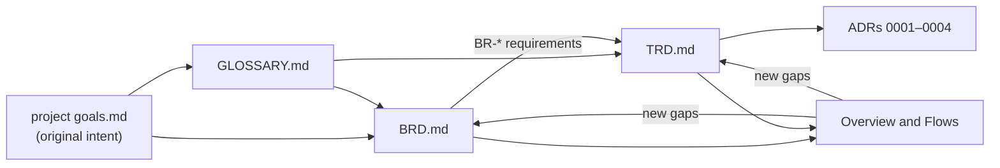

## 2. System at a glance

One Business, one outlet, online-only except printing ([ADR-0001](adr/0001-single-business-single-outlet.md), [ADR-0003](adr/0003-online-only-with-future-local-server.md)). Every Module reads the same **Product catalog** and works on the same **Bills**. All cash ends up in one **Cash Drawer**.

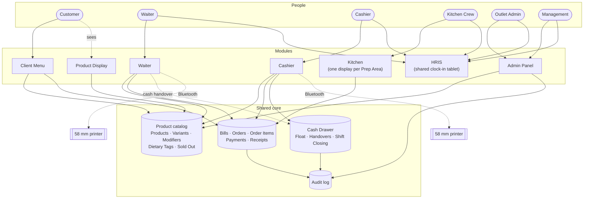

---

## 3. Operational workflows

Legend: rounded boxes are start/end, diamonds are decisions, hexagons jump to another workflow, **✅ G-nn** marks a branch added by the gap review.

### OP-01 Customer arrival, joining and Rejoining the Bill

Rules: BR-CM-01, BR-CM-02, BR-CM-12, BR-CM-13, BR-R-01, BR-R-26, BR-P-02, BR-P-07.

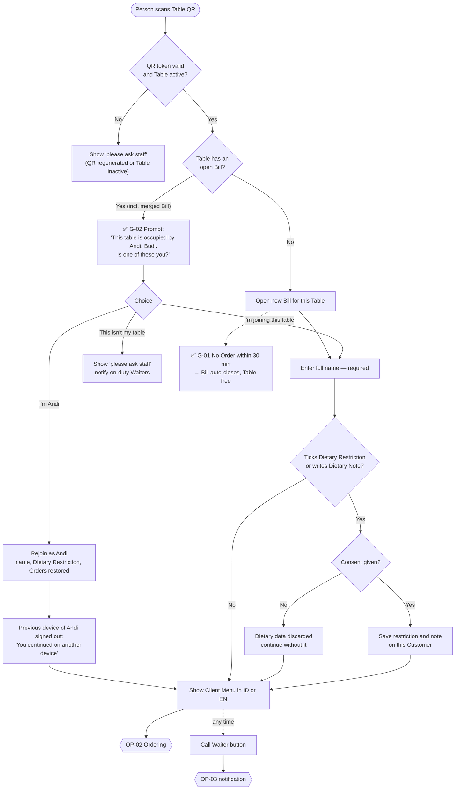

### OP-02 Customer ordering, including adding Orders while the Bill is open

Rules: BR-CM-03 to BR-CM-15, BR-PC-04, BR-R-D1 to BR-R-D3, BR-R-06, BR-R-27.

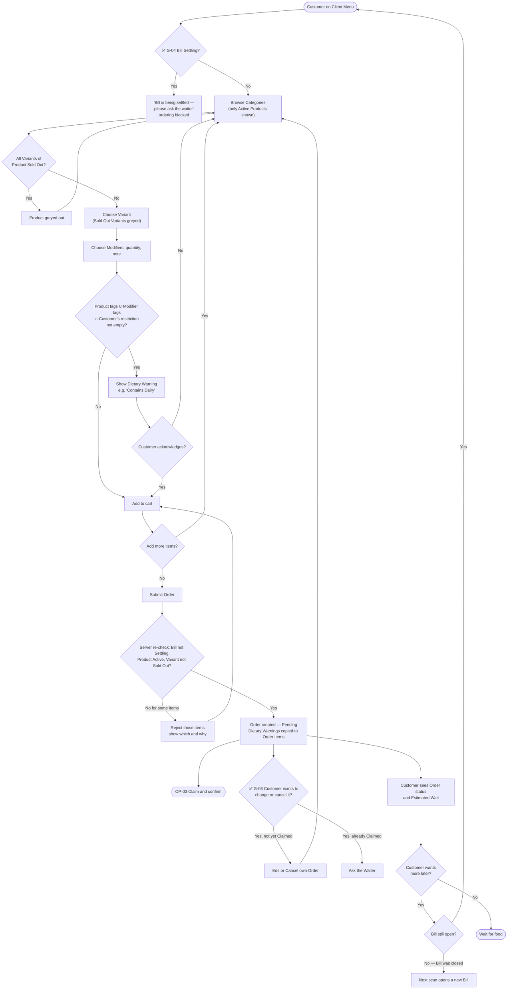

### OP-03 Waiter Claim, escalation and confirmation

Rules: BR-WT-01, BR-WT-02, BR-WT-05, BR-WT-10, BR-WT-11, BR-R-06, BR-R-34, TR-SM-03, TR-SM-05.

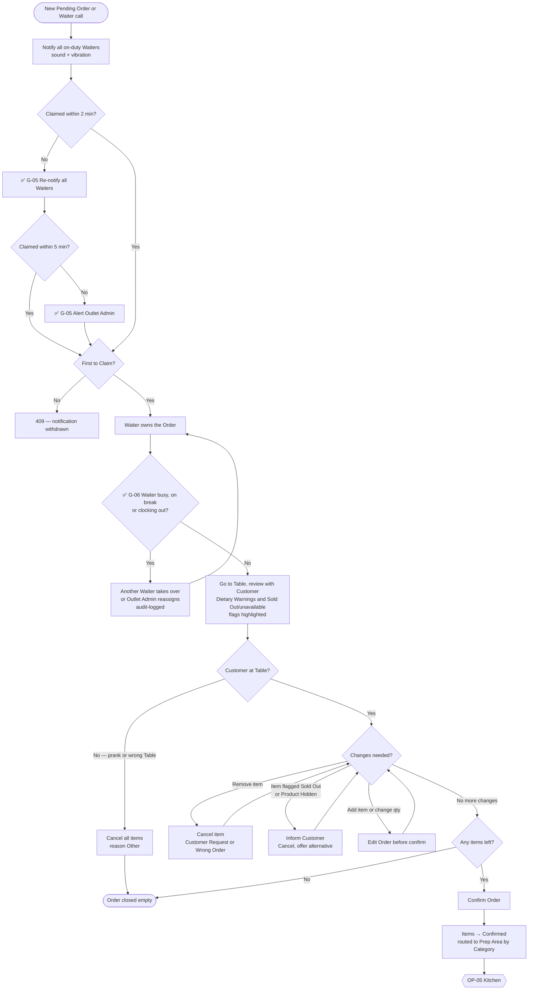

### OP-04 Waiter or Cashier direct entry

Rules: BR-WT-03, BR-CS-01.

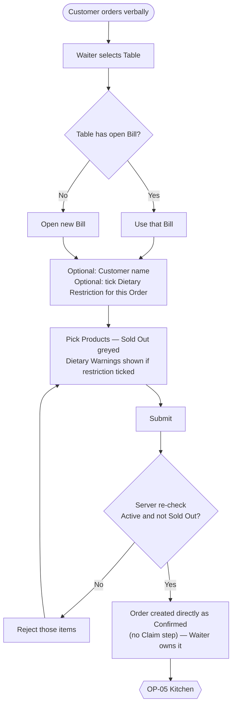

### OP-05 Kitchen processing

Rules: BR-KT-01 to BR-KT-06, BR-R-07, TR-KT-01.

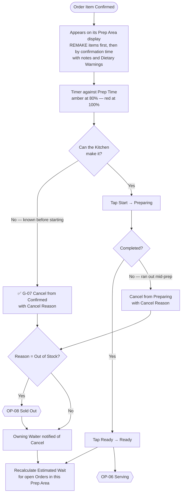

### OP-06 Serving and Remake

Rules: BR-WT-09, BR-WT-12, BR-KT-06, BR-R-09, BR-R-33.

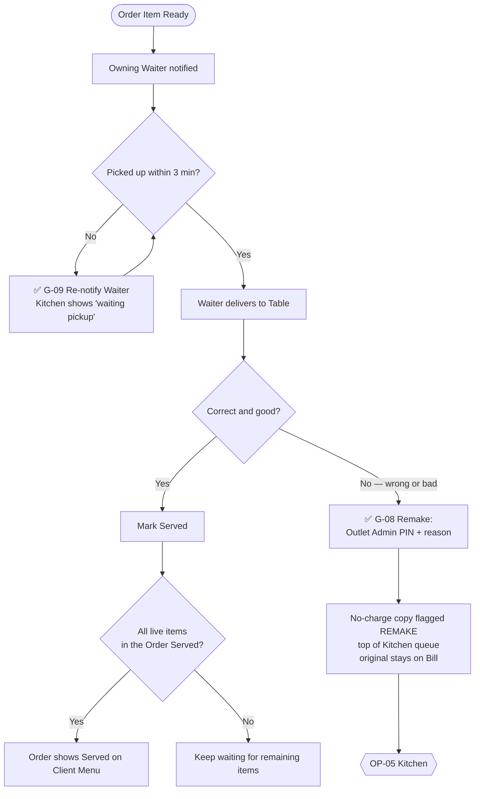

### OP-07 Cancel or Void — which one applies

Rules: BR-R-07, BR-R-08, BR-R-10, TR-AUTH-06.

```mermaid
flowchart TD
  A([Need to remove an Order Item]) --> B{Item status?}
  B -->|"Pending, not Claimed"| C0["Customer may Cancel own item<br/>— or Waiter Cancels"]
  B -->|"Pending (Claimed) or Confirmed"| C["Waiter or Cashier Cancels<br/>Cancel Reason — no PIN"]
  B -->|"Confirmed or Preparing"| D["Kitchen Cancels<br/>Cancel Reason — no PIN"]
  B -->|"Ready or Served"| E{"✅ G-10 Is the item's Bill<br/>or Sub-bill already paid?"}
  E -->|No| F["Void — PIN Override<br/>Outlet Admin or Management<br/>reason required"]
  E -->|Yes| G{{"OP-11 Refund"}}
  C0 --> J
  C --> H{Reason = Out of Stock?}
  D --> H
  H -->|Yes| I{{"OP-08 Sold Out"}}
  H -->|No| J[Item excluded from totals]
  I --> J
  F --> K[Audit log entry] --> J
```

### OP-08 Sold Out and unavailable Products

Rules: BR-R-11 to BR-R-13, BR-R-35, BR-ADM-07, TR-SM-04, TR-SM-06.

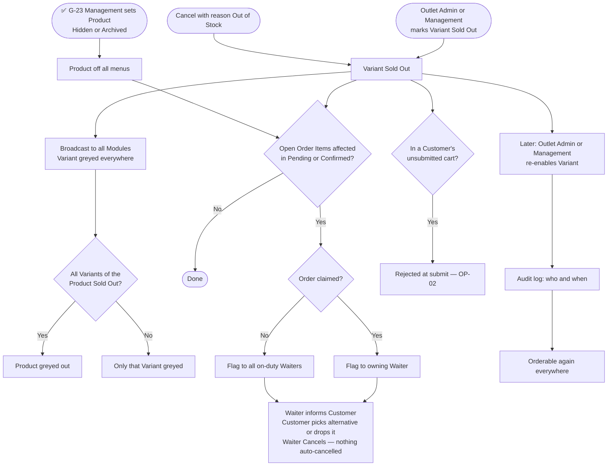

### OP-09 Bill changes: Move, Merge, Split

Rules: BR-WT-06, BR-R-03, BR-R-04, BR-R-28, BR-R-29, TR-DM-03, TR-DM-06, TR-PR-04.

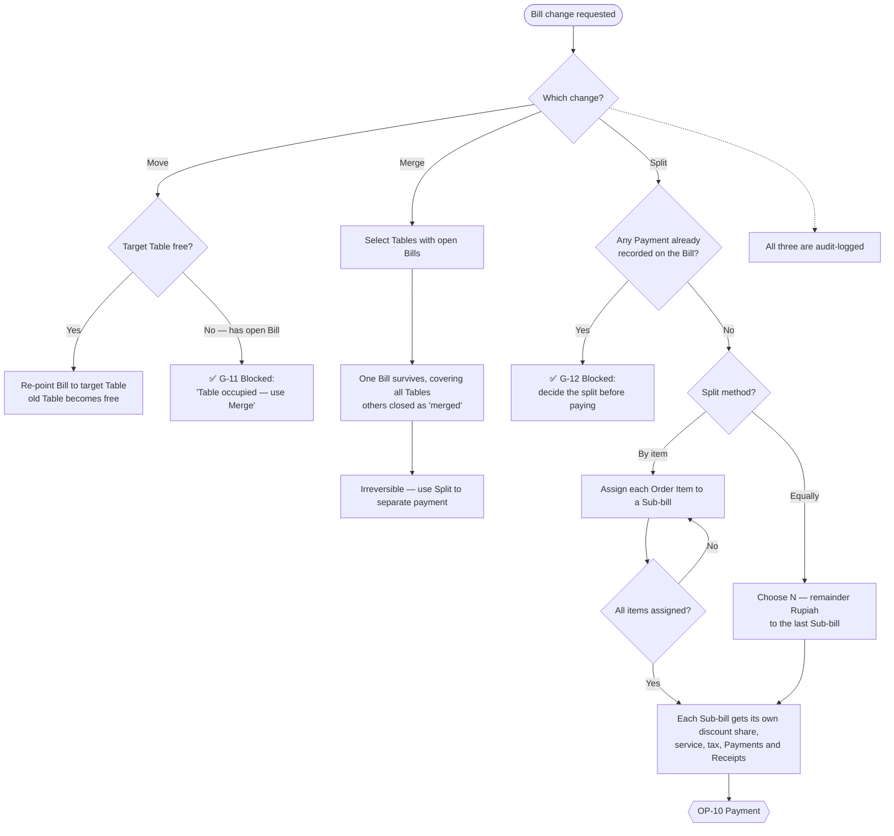

### OP-10 Payment and closing the Bill

Rules: BR-WT-07, BR-WT-08, BR-WT-13 to BR-WT-15, BR-R-14 to BR-R-21, BR-R-27, BR-R-30 to BR-R-32, BR-R-36, BR-R-37.

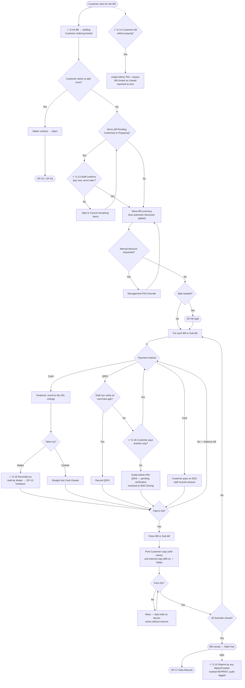

### OP-11 Refund

Rules: BR-R-20, BR-CS-03, BR-ADM-06, TR-AUTH-06.

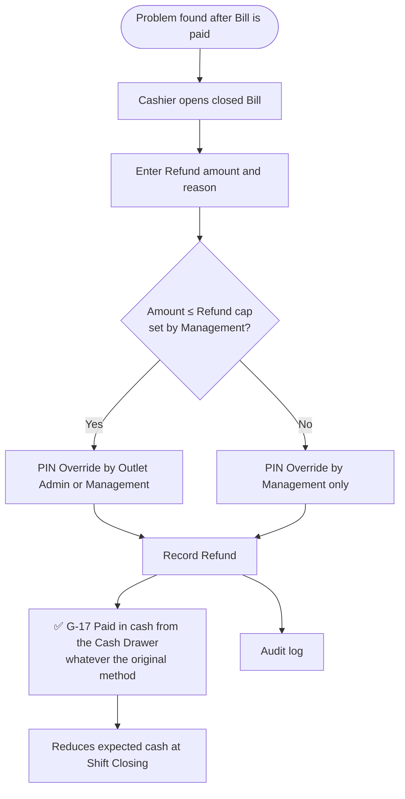

### OP-12 Takeaway

Rules: BR-CS-02, TR-PAY-04.

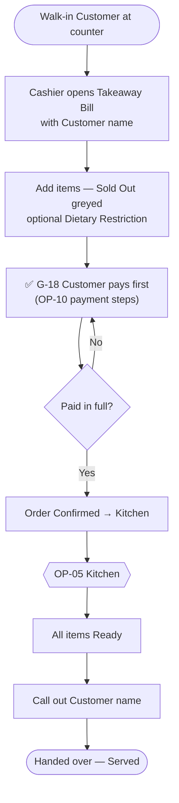

### OP-13 Cash Drawer: float, handover and Shift Closing

Rules: BR-CS-04 to BR-CS-07, BR-WT-14, BR-HR-07, TR-PAY-01 to TR-PAY-03.

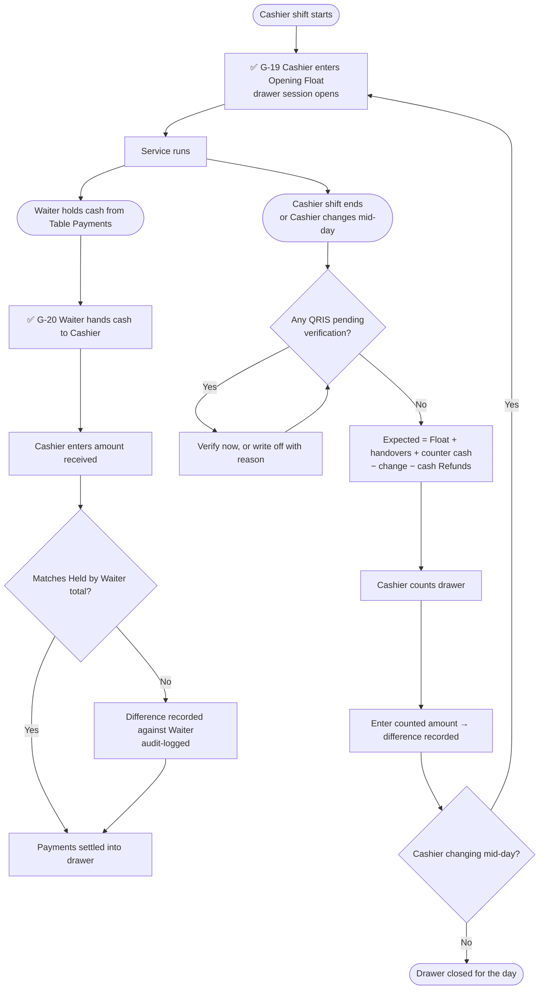

### OP-14 Internet outage

Rules: BR-NF-05, BR-CS-08, TR-NF-07, ADR-0003.

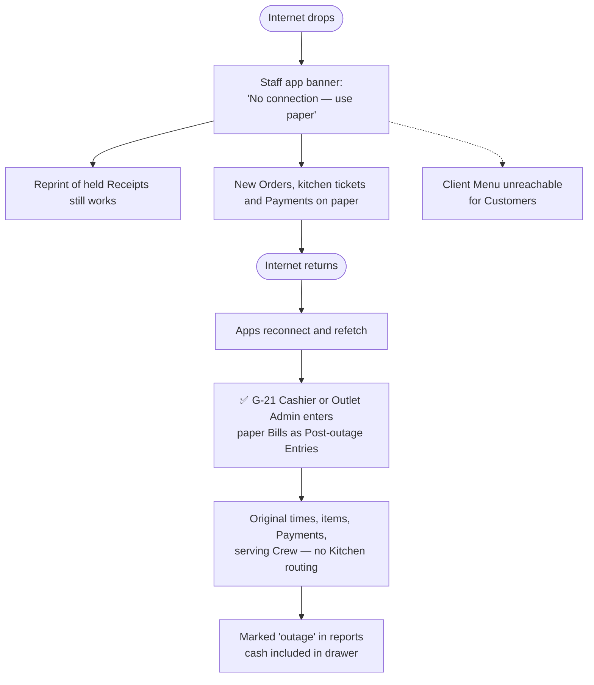

### OP-15 HRIS

Rules: BR-HR-01 to BR-HR-07, BR-WT-11, TR-AUTH-08.

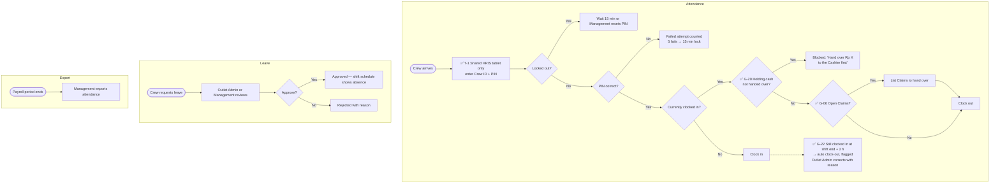

### OP-16 Catalog and Product Display changes

Rules: BR-PC-*, BR-ADM-01 to BR-ADM-10, BR-PD-*, BR-R-35, TR-PC-05.

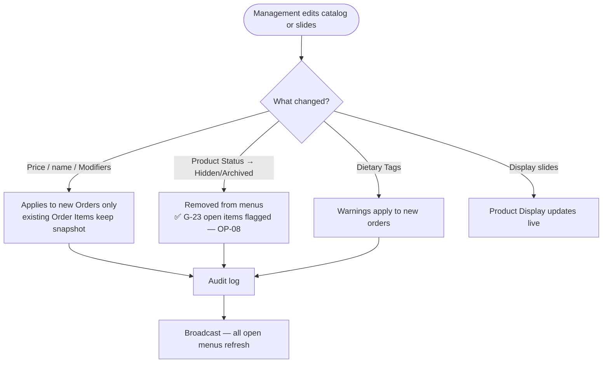

### OP-17 Customer data lifecycle

Rules: BR-P-01 to BR-P-07, ADR-0002.

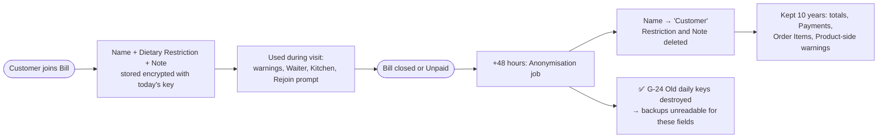

---

## 4. State machines

### Order Item

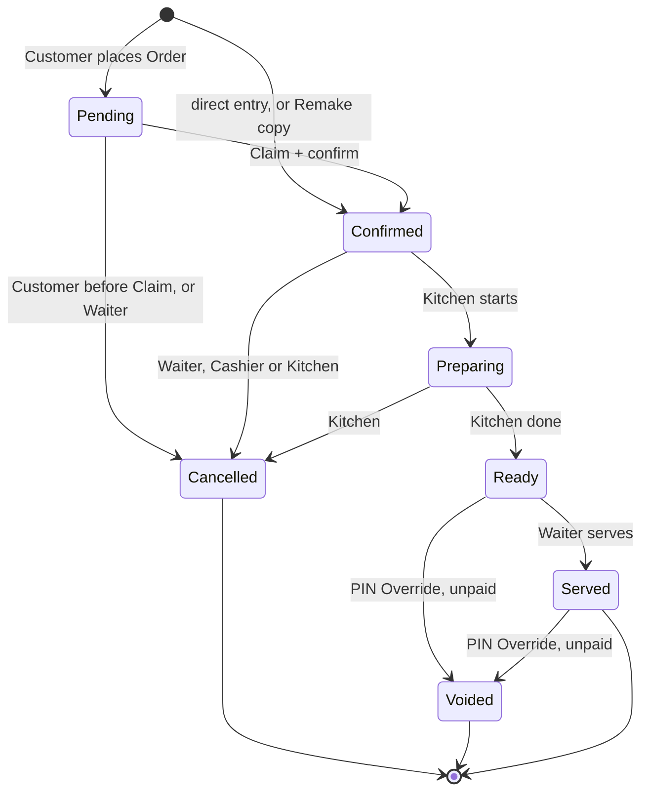

A Remake does not change the original item's state; it creates a new no-charge item that starts at Confirmed.

### Order (derived from its items)

```mermaid
stateDiagram-v2
  [*] --> Pending : placed by Customer
  [*] --> Confirmed : direct entry
  Pending --> Pending : Customer edits before Claim
  Pending --> Claimed : Waiter Claims
  Claimed --> Claimed : takeover or reassign
  Claimed --> Confirmed : Waiter confirms
  Pending --> Closed : all items Cancelled
  Claimed --> Closed : all items Cancelled
  Confirmed --> Ready : all live items Ready
  Ready --> Served : all live items Served
  Confirmed --> Closed : all items Cancelled
  Served --> [*]
  Closed --> [*]
```

### Bill

```mermaid
stateDiagram-v2
  [*] --> Open : first scan or first direct Order
  Open --> Open : new Orders, Move, Split, Rejoin
  Open --> Closed : no Orders after 30 min
  Open --> Settling : payment started
  Settling --> Open : Waiter unlocks
  Settling --> Closed : fully paid
  Open --> Closed : fully paid
  Open --> Unpaid : Outlet Admin PIN + reason
  Settling --> Unpaid : Outlet Admin PIN + reason
  Open --> Merged : absorbed into another Bill
  Closed --> Closed : Refund or reprint
  Closed --> Anonymised : 48 h later
  Unpaid --> Anonymised : 48 h later
  Merged --> [*]
  Anonymised --> [*]
```

### Payment

```mermaid
stateDiagram-v2
  [*] --> Settled : Cashier cash, card, verified QRIS
  [*] --> HeldByWaiter : Waiter cash
  [*] --> PendingVerification : unverified QRIS + PIN
  HeldByWaiter --> Settled : Cash Handover received
  PendingVerification --> Settled : verified
  PendingVerification --> WrittenOff : at Shift Closing, with reason
  Settled --> [*]
  WrittenOff --> [*]
```

### Product and Variant

```mermaid
stateDiagram-v2
  state Product {
    [*] --> Active
    Active --> Hidden
    Hidden --> Active
    Active --> Archived
    Hidden --> Archived
  }
  state Variant {
    [*] --> Available
    Available --> SoldOut : manual or Cancel Out of Stock
    SoldOut --> Available : Outlet Admin or Management re-enables
  }
```

---

## 5. Backend flows

### BE-01 Sign-in and lockout

```mermaid
sequenceDiagram
  participant D as Device
  participant API as Go API
  participant DB as PostgreSQL
  D->>API: POST /auth/login (crew_id, pin)
  API->>DB: load crew row
  alt locked_until in the future
    API-->>D: 423 Locked (retry after)
  else PIN wrong
    API->>DB: failed_attempts + 1, lock 15 min at 5
    API-->>D: 401
  else PIN correct
    API->>DB: reset failed_attempts, create session (ends at shift end or 12 h)
    API-->>D: 200 + HttpOnly session cookie
  end
```

### BE-02 QR scan: join or Rejoin

```mermaid
sequenceDiagram
  participant C as Client Menu (new device)
  participant O as Old device
  participant API as Go API
  participant DB as PostgreSQL
  participant HUB as WebSocket hub
  C->>API: GET /public/tables/{qr_token}
  API->>DB: find open Bill for Table
  alt no open Bill
    API-->>C: free
    C->>API: POST join (name, tags, note, consent)
    API->>DB: BEGIN, lock Table, INSERT bill + customer_entry (encrypted), COMMIT
    API-->>C: guest token
  else open Bill
    API->>DB: decrypt Customer names on Bill
    API-->>C: occupied + names
    alt "I'm Andi"
      C->>API: POST rejoin (customer_entry_id)
      API->>DB: set active_device_id, revoke old token
      API->>DB: NOTIFY customer:{id}
      DB-->>HUB: event
      HUB-->>O: You continued on another device
      API-->>C: guest token for Andi
    else "I'm joining this table"
      C->>API: POST join
      API->>DB: INSERT customer_entry on existing Bill
      API-->>C: guest token
    else "This isn't my table"
      C->>API: POST not-mine
      API->>DB: NOTIFY waiters
      API-->>C: please ask staff
    end
  end
```

### BE-03 Place Order → notify Waiters

```mermaid
sequenceDiagram
  participant C as Client Menu
  participant API as Go API
  participant DB as PostgreSQL
  participant HUB as WebSocket hub
  participant W as Waiter devices
  C->>API: POST /public/orders (Idempotency-Key)
  API->>DB: BEGIN
  API->>DB: verify Bill open and not settling
  API->>DB: verify Products Active, Variants not Sold Out
  API->>DB: INSERT order (Pending), order_items with snapshots
  API->>DB: compute Dietary Warnings → order_item_dietary_warning
  API->>DB: NOTIFY waiters + bill:{id}
  API->>DB: COMMIT
  API-->>C: 201 Order
  DB-->>HUB: LISTEN event
  HUB-->>W: order.pending (id only)
  W->>API: GET order (refetch)
```

### BE-04 Claim race, escalation and takeover

```mermaid
sequenceDiagram
  participant W1 as Waiter A
  participant W2 as Waiter B
  participant J as Escalation job
  participant API as Go API
  participant DB as PostgreSQL
  participant HUB as WebSocket hub
  J->>DB: Orders unclaimed past 2 min / 5 min
  J->>DB: NOTIFY waiters (re-notify) or outlet-admin (escalate)
  W1->>API: POST /orders/{id}/claim
  W2->>API: POST /orders/{id}/claim
  API->>DB: UPDATE order SET claimed_by=A WHERE claimed_by IS NULL
  DB-->>API: 1 row
  API-->>W1: 200 Claimed
  API->>DB: same UPDATE for B
  DB-->>API: 0 rows
  API-->>W2: 409 Already claimed
  API->>DB: NOTIFY waiters order.claimed
  DB-->>HUB: event
  HUB-->>W2: withdraw notification
  W2->>API: POST /orders/{id}/takeover (later)
  API->>DB: claimed_by=B, INSERT claim_transfer, audit_log
  API->>DB: NOTIFY waiters
  HUB-->>W1: Claim taken over by B
```

### BE-05 Confirm → Kitchen → Ready (with Estimated Wait)

```mermaid
sequenceDiagram
  participant W as Waiter
  participant API as Go API
  participant DB as PostgreSQL
  participant HUB as WebSocket hub
  participant K as Prep Area display
  participant C as Client Menu
  W->>API: POST /orders/{id}/confirm
  API->>DB: items Pending → Confirmed (WHERE status = Pending)
  API->>DB: NOTIFY prep-area:{id} for each Prep Area involved
  DB-->>HUB: events
  HUB-->>K: new items (Remakes sorted first)
  K->>API: transition → Preparing, later → Ready
  API->>DB: optimistic status update, set ready_at
  API->>API: recompute Estimated Wait for Prep Area queue
  API->>DB: NOTIFY bill:{id}, waiters
  HUB-->>C: status + Estimated Wait
  HUB-->>W: item Ready
```

### BE-06 Cancel with Out of Stock → Sold Out cascade

```mermaid
sequenceDiagram
  participant K as Kitchen or Waiter
  participant API as Go API
  participant DB as PostgreSQL
  participant HUB as WebSocket hub
  K->>API: POST /order-items/{id}/cancel (reason out_of_stock)
  API->>DB: BEGIN
  API->>DB: item → Cancelled (guarded by role and status)
  API->>DB: variant.sold_out = true, source cancel_out_of_stock
  API->>DB: flag open Pending/Confirmed items with same Variant
  API->>DB: INSERT audit_log
  API->>DB: NOTIFY menu, waiters, prep-area
  API->>DB: COMMIT
  DB-->>HUB: events
  HUB-->>HUB: fan out to all menus (grey out) and owning Waiters (flags)
```

### BE-07 PIN Override (Void, Remake, Unpaid, manual discount, Refund, pending QRIS)

```mermaid
sequenceDiagram
  participant S as Staff device
  participant A as Approver (on same device)
  participant API as Go API
  participant DB as PostgreSQL
  S->>A: hand device for approval
  A->>API: POST /auth/override (approver PIN, action)
  API->>DB: verify approver role allows action (and Refund cap)
  API-->>S: one-time override token (60 s)
  S->>API: POST action endpoint + X-Override-Token
  API->>DB: BEGIN, apply action, audit_log (actor + approver), COMMIT
  API-->>S: 200
```

### BE-08 Settle, pay, close and print

```mermaid
sequenceDiagram
  participant S as Waiter/Cashier PWA
  participant API as Go API
  participant DB as PostgreSQL
  participant P as Bluetooth printer
  S->>API: POST /bills/{id}/settle
  API->>DB: status → settling, NOTIFY bill:{id}
  S->>API: GET /bills/{id}/summary
  API->>API: pricing engine (discounts → service → tax)
  API-->>S: totals + unfinished-item warning
  loop until fully paid
    S->>API: POST /bills/{id}/payments (method, amount, Idempotency-Key)
    API->>DB: INSERT payment (settled / held_by_waiter / pending_verification)
  end
  S->>API: POST /bills/{id}/close (pay_now_serve_later if needed)
  API->>DB: status → closed, closed_at
  API-->>S: Receipt data
  S->>S: hold Receipt data locally
  S->>P: ESC/POS over Web Bluetooth — Customer copy
  S->>P: ESC/POS — internal copy
  S->>API: record receipt_print rows
  alt print fails
    S->>S: show Retry (works offline)
  end
```

### BE-09 Cash Handover and Shift Closing

```mermaid
sequenceDiagram
  participant W as Waiter
  participant C as Cashier
  participant API as Go API
  participant DB as PostgreSQL
  C->>API: POST /drawer-sessions (opening_float)
  API->>DB: INSERT drawer_session
  W->>C: hands over cash
  C->>API: GET /crew/{waiter}/held-cash
  API-->>C: expected Rp X
  C->>API: POST /cash-handovers (waiter, received)
  API->>DB: INSERT cash_handover, payments → settled, difference audit-logged
  W->>API: POST /attendance/clock (clock out)
  API->>DB: check no held_by_waiter payments
  API-->>W: ok
  C->>API: POST /drawer-sessions/{id}/close (counted)
  API->>DB: refuse if pending_verification QRIS remain
  API->>DB: expected = float + handovers + counter cash − change − cash refunds
  API->>DB: store counted and difference
  API-->>C: Shift Closing summary
```

### BE-10 Realtime pipeline

```mermaid
flowchart LR
  TX["API transaction<br/>COMMIT"] --> N["pg NOTIFY<br/>(topic, entity id, version)"]
  N --> L[Go LISTEN goroutine]
  L --> H[WebSocket hub]
  H -->|"waiters"| WD[Waiter devices]
  H -->|"outlet-admin"| OA[Outlet Admin devices]
  H -->|"prep-area:id"| KD[Kitchen displays]
  H -->|"bill:id"| CM[Customer phones]
  H -->|"customer:id"| CD[Device revoked on Rejoin]
  H -->|"menu"| ALL[All menus]
  H -->|"display"| TV[Product Display]
  WD & OA & KD & CM & ALL & TV -->|"refetch via TanStack Query"| API[REST API]
```

### BE-11 Scheduled jobs

```mermaid
flowchart TD
  S([Scheduler — advisory lock]) --> J1["Every 15 s: Claim re-notify / escalate<br/>pickup reminders"]
  S --> J2["Every 1 min: close empty Bills > 30 min<br/>activate/deactivate promos"]
  S --> J3["Every 5 min: auto clock-out<br/>past shift end + 2 h"]
  S --> J4["Every 1 h: Anonymise Bills<br/>closed/unpaid > 48 h"]
  S --> J5["Daily: destroy expired data keys<br/>run backup"]
  J1 & J2 & J3 & J4 & J5 --> F{Failure?}
  F -->|Yes| A[Alert via monitoring]
  F -->|No| OK([Done])
```

---

## 6. Gap resolution log

All gaps found by the first version of these charts were resolved on 2026-10-26.

| ID | Gap | Decision | Spec reference |
|---|---|---|---|
| G-01 | Bill opened, no Order placed | Auto-close after 30 min | BR-R-26 |
| G-02 | Customer scans again | Prompt with full names: Rejoin as self, join as new, or "not my table"; bound to Bill, latest device wins | BR-CM-12, BR-CM-13, TR-AUTH-07 |
| G-03 | Customer edits own Order | Allowed until Claimed | BR-CM-14 |
| G-04 | Order during payment | Bill Settling blocks Customer Orders; Waiter can unlock | BR-R-27, BR-CM-15 |
| G-05 | Unclaimed Order or call | Re-notify at 2 min, alert Outlet Admin at 5 min | BR-WT-10 |
| G-06 | Claim handover | Takeover by Waiter or reassign by Outlet Admin; listed at clock-out | BR-WT-11, BR-R-34 |
| G-07 | Kitchen can't make Confirmed item | Kitchen may Cancel from Confirmed | BR-KT-04, BR-R-07 |
| G-08 | Wrong or bad item | Remake: Outlet Admin PIN, no-charge copy, prioritised | BR-WT-12, BR-R-33 |
| G-09 | Ready not picked up | Re-notify at 3 min, "waiting pickup" on Kitchen | BR-WT-09, BR-KT-06 |
| G-10 | Void on partly paid split | Void only on unpaid Sub-bills; else Refund | BR-R-08 |
| G-11 | Move onto occupied Table | Blocked; use Merge | BR-R-28 |
| G-12 | Split after Payment | Blocked | BR-R-29 |
| G-13 | Pay with unfinished items | Allowed with staff "pay now, serve later" | BR-R-31 |
| G-14 | Walkout | Unpaid Bill via Outlet Admin PIN + reason | BR-R-32 |
| G-15 | Reprint | Any Waiter/Cashier, marked REPRINT, audit-logged | BR-WT-13, BR-R-37 |
| G-16 | QRIS unverifiable | Another method, or pending verification with Outlet Admin PIN | BR-R-30, BR-CS-07 |
| G-17 | Refund method | Cash from the Cash Drawer | BR-R-20 |
| G-18 | Takeaway pay timing | Pay first | BR-CS-02 |
| G-19 | Opening float | Entered by Cashier per drawer session | BR-CS-04 |
| G-20 | Cash drawer | One drawer at Cashier; Waiter cash Held by Waiter until Cash Handover; clock-out blocked while holding cash | BR-CS-05, BR-CS-06, BR-WT-14, BR-HR-07, BR-R-36 |
| G-21 | Paper during outage | Post-outage Entry by Cashier or Outlet Admin | BR-CS-08 |
| G-22 | Forgot to clock out | Auto clock-out at shift end + 2 h, corrected by Outlet Admin | BR-HR-06 |
| G-23 | Product Hidden with Pending items | Flagged like Sold Out | BR-R-35 |
| G-24 | Backups beyond 48 h | Crypto-shredding | BR-P-06, TR-RET-04, ADR-0002 |
| T-1 | Clock-in location | Shared HRIS tablet only | BR-HR-03, TR-AUTH-08 |
| T-3 | Shared-device session length | Shift end or 12 h | BR-R-38, TR-AUTH-09 |
| T-4 | Kitchen parallel capacity | Kitchen 2, Bar 1, adjustable | TR-KT-02 |
