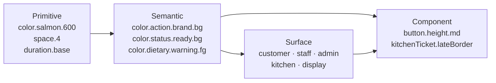
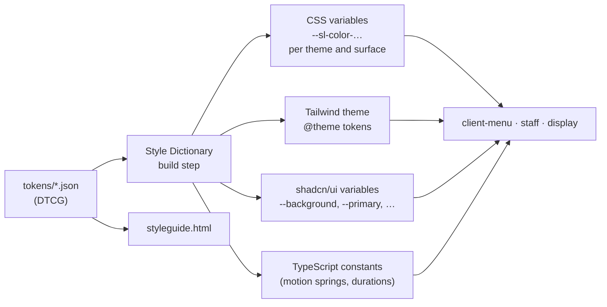

# Design Tokens

Tokens are the single source of truth for every visual decision. Apps never hard-code a colour, size, radius, shadow or timing.

## 1. Three tiers

| Tier | Answers | Example | Who may use it |
|---|---|---|---|
| **Primitive** | What values exist? | `color.salmon.600 = #B9512B` | Only semantic and surface tokens |
| **Semantic** | What is it for? | `color.action.brand.bg → {color.salmon.600}` | Components, app code |
| **Surface** | How does this app speak? | `customer.color.primary.bg → {color.action.brand.bg}`, `customer.radius.card → {radius.xl}` | Components, app shell |
| **Component** | What does this part use? | `button.radius → {radius.control}` | That component only |

Rule: **app code references semantic, surface or component tokens, never primitives.** Changing a brand colour then means editing one primitive.

## 2. Files

All in [tokens/](tokens/), in the W3C Design Tokens Community Group format (`$type`, `$value`, `$description`, `{alias}` references).

| File | Contents |
|---|---|
| `primitive.json` | 11 colour scales + white/black, font families/weights/line heights/letter spacing, space, radius, shadow, duration, easing, spring, opacity, z-index, breakpoints, touch and icon sizes |
| `semantic.light.json` | Colour roles in light mode |
| `semantic.dark.json` | The same roles in dark mode (identical names, different references) |
| `surface.customer.json` | Client Menu: Rice canvas, Salmon Deep primary, pill controls, 16 px base, expressive |
| `surface.staff.json` | Waiter/Cashier: Neutral canvas, Nori primary, 10 px controls, 16 px base + amount sizes, functional |
| `surface.admin.json` | Admin/HRIS: 14 px base, dense |
| `surface.kitchen.json` | Kitchen: dark, 24 px base, 64 px touch, 8 px tickets |
| `surface.display.json` | Product Display: dark, 32–120 px type, expressive |
| `component.json` | Button, input, card, chip, sheet, productCard, dietaryBadge, kitchenTicket, pinPad, paymentPad, toast, focusRing |

## 3. Naming

`category.role.variant.state`, lower camelCase, dots between levels.

- `color.text.secondary`
- `color.action.brand.bgHover`
- `color.status.preparing.icon`
- `font.size.amountLg` (surface)
- `radius.card` (surface alias) vs `radius.xl` (primitive)

Domain words come from the Glossary: `status.pending`, `dietary.warning`, `soldOut`, `bill.settling`, `timer.late`.

## 4. Status tone pattern

Every status, feedback and Dietary Warning tone exposes the same six roles, so one component can render any of them:

| Role | Light | Dark | Used for |
|---|---|---|---|
| `bg` | hue 100 | hue 950 | Chip / banner background |
| `fg` | hue 800 | hue 200 | Text on `bg` |
| `border` | hue 300 | hue 700 | Outline |
| `icon` | hue 600 | hue 400 | Icon on surface |
| `solid` | hue 600 | hue 400 | Kitchen ticket header, filled badge |
| `onSolid` | white | hue 950 | Text on `solid` |

## 5. Pipeline

- Output lives in `web/packages/ui/tokens/` (generated, never edited by hand).
- CSS variables are prefixed `--sl-`; themes switch with `[data-theme="dark"]`, surfaces with `[data-surface="kitchen"]`.
- shadcn/ui mapping (light, staff surface):

| shadcn variable | Token |
|---|---|
| `--background` | `color.bg.canvas` |
| `--foreground` | `color.text.primary` |
| `--card` / `--popover` | `color.bg.surface` / `color.bg.raised` |
| `--primary` / `--primary-foreground` | surface `color.primary.bg` / `.fg` |
| `--secondary` / `--secondary-foreground` | `color.action.secondary.bg` / `.fg` |
| `--muted` / `--muted-foreground` | `color.bg.sunken` / `color.text.muted` |
| `--accent` | `color.action.secondary.bgHover` |
| `--destructive` | `color.action.danger.bg` |
| `--border` / `--input` / `--ring` | `color.border.default` / `color.border.input` / `color.border.focus` |
| `--radius` | surface `radius.control` |

## 6. Changing tokens

1. Edit the JSON (primitive for a value, semantic for a role mapping).
2. Re-run the contrast check ([COLOR.md §5](COLOR.md#5-contrast-proof)); a change that drops a pair below its threshold is rejected.
3. Rebuild; update [styleguide.html](styleguide.html).
